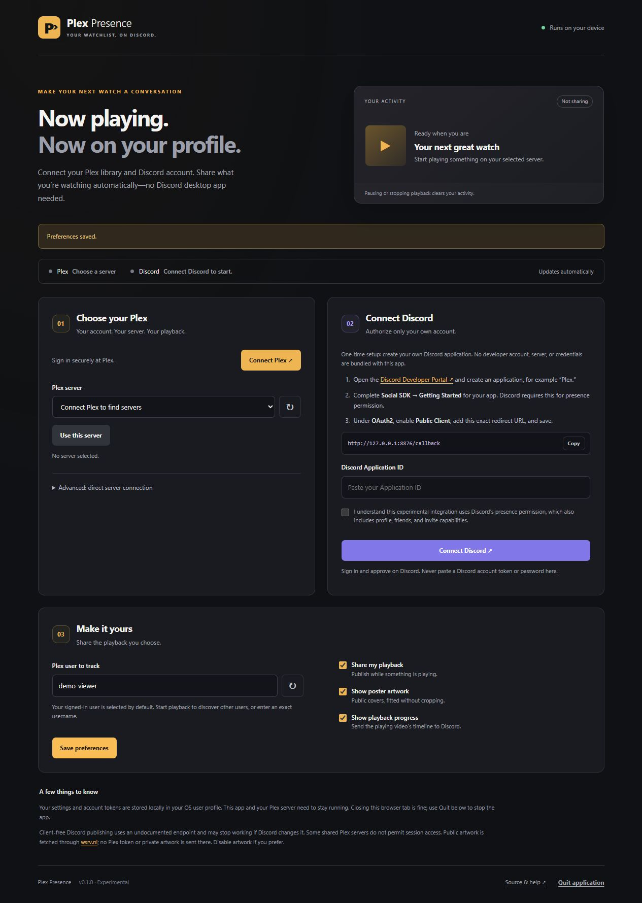

# Plex Presence

Show your Plex playback on your own Discord profile, with a guided local setup GUI and **your choice of Discord desktop or always-on mode**. Runs on Windows, macOS, Linux, and a 64-bit Raspberry Pi.

[Download a release](https://github.com/sixtenths/plex-presence/releases) · [Build status](https://github.com/sixtenths/plex-presence/actions) · [Security and privacy](SECURITY.md)



**Experimental:** Discord's OAuth permission is documented, but the headless presence publishing endpoint is not a stable public API. Discord may change or disable it. Always-on mode requires your own Discord application and Social SDK; desktop mode does not. This independent community project is inspired by [phin05/discord-rich-presence-plex](https://github.com/phin05/discord-rich-presence-plex).

## Features

- Sign in to Plex and choose your own server, or enter an address and token in Advanced setup.
- Select the Plex username to track and authorize your own Discord account.
- Show movies, episodes, and music, with optional public artwork and playback progress.
- Shows tagged **Anime** in Plex genres or labels use **Episode 42** instead of **S03E01**. Numbering follows Plex's regular-season order, excludes season-zero specials, and uses an explicit absolute index when available. It also detects shows whose episode indices already continue across seasons, avoiding double counting. Otherwise it adds the highest episode index in each earlier season; incomplete libraries or alternative ordering can differ from an external anime database. Unavailable metadata or missing whole earlier seasons retains the standard season/episode label.
- **Clear presence on pause, stop, buffering, or loss of server access.** Resume restores it. No paused activity or paused timer.
- Save settings locally and refresh Discord authorization automatically.
- Run on an always-on machine without leaving Discord open. The Plex server must still be running: a Pi cannot see playback from a powered-off PC.

Playback is polled roughly every five seconds. Network latency, Plex session reporting, Discord caching, and rate limits can delay updates. Disabling progress removes the supplied playback timestamps; Discord may still display its own activity duration.

## Download and run

**Windows: download [PlexPresence-Setup-windows-x64.exe](https://github.com/sixtenths/plex-presence/releases/latest/download/PlexPresence-Setup-windows-x64.exe), run the installer, then open Plex Presence from its Start menu or desktop shortcut.** It installs for your Windows user, includes Python and dependencies, and registers an uninstaller. Quit the app before upgrading. Uninstall removes the program; saved account settings remain in the separate data directory below.

A **12-part setup guide opens on first launch**. Use **Help / Setup guide** to reopen it. It explains installation, Plex Home, shared servers, both Discord modes, artwork, troubleshooting, everyday use, privacy, and Raspberry Pi setup.

On macOS/Linux, choose the archive for your machine and extract the **whole folder** before launching. All native downloads include Python and dependencies.

| Platform | Download | Launch |
| --- | --- | --- |
| Windows x64 | `PlexPresence-Setup-windows-x64.exe` | Install, then use the Plex Presence shortcut |
| macOS Apple Silicon | `PlexPresence-macos-arm64.zip` | `PlexPresence.app` |
| macOS Intel | `PlexPresence-macos-x64.zip` | `PlexPresence.app` |
| Linux / Raspberry Pi arm64 | `PlexPresence-linux-arm64.tar.gz` | `./PlexPresence/PlexPresence` |
| Linux x64 | `PlexPresence-linux-x64.tar.gz` | `./PlexPresence/PlexPresence` |

Builds are unsigned and macOS builds are not notarized. Windows SmartScreen or macOS Gatekeeper may require approval using the OS's normal per-app controls. Use only downloads from this repository. Running from source is also supported.

Native builds are tested on the current Windows GitHub runner, macOS 15 (both architectures), and Ubuntu 22.04 (both architectures). Older operating systems are not guaranteed. Linux binaries require glibc 2.35 or newer; Alpine/musl is unsupported. For older compatible Linux systems, use Python 3.11+ from source. No 32-bit Pi or Windows ARM native build is supplied.

The app opens `http://127.0.0.1:8765` in your default browser. Closing the browser leaves the watcher running. Use **Quit app** in the GUI to stop it and clear presence. Launch it again to resume with saved settings. The Windows installer enables **Start when I sign in** by default; you can uncheck it during installation or disable Plex Presence in Windows Startup apps. Startup runs quietly without opening a browser. Right-click the tray icon for **Open settings / setup guide** or **Quit Plex Presence**. Launching the Start menu shortcut again opens the already-running app. macOS/Linux users can configure login startup using their OS or service manager.

## First-time setup

### 1. Plex

Click **Connect Plex**, sign in on Plex's website, and approve the connection. Return to the GUI, refresh the server list if needed, choose a server, and click **Use server**. Servers you own use session polling. Shared servers use a playback notification connection authenticated with your personal shared-server token, without requesting the owner-only session list.

Enter the Plex username to track. **Find active users** suggests names from current playback; start a stream if a name is missing, or type the exact username yourself. In shared-server mode the tracked user is locked to the signed-in profile. After connecting or restarting the app, start or resume playback so Plex sends a fresh event. You still need library access and a reachable server; an offline server or denied notification connection cannot be bypassed.

Advanced setup accepts your server URL, token, and username. Prefer HTTPS. Local HTTP sends the token unencrypted on your network. Never put a token in the URL or a public issue.

### Plex Home / managed profiles

If you watch as a Plex Home profile, expand **Plex Home: choose a profile**, click **Load Home profiles**, select the profile, and enter its four-digit PIN if protected. Click **Use this profile**, then select one of that profile's accessible servers. This obtains that profile's own access token; the PIN is not saved. You do not need the server owner's token.

A managed profile cannot sign in independently: an existing full member of its Plex Home first signs in normally, then switches to the profile. The original login token is retained locally to allow later profile switching. Switching profiles clears the previous server selection. Regular shared users simply sign in with their own Plex account and choose a server marked **(shared)**; no Home switch is needed.

The notification listener reconnects automatically and clears presence on pause, stop, disconnection, or when playback events go stale. It does not request control of the Plex player. See [Plex Home switching](https://support.plex.tv/articles/204232453-fast-user-switching/) and [managed accounts](https://support.plex.tv/articles/203948776-managed-users/).

### 2. Discord

**Discord desktop (default):** open Discord on the same Windows, macOS, or Linux computer and sign in. Plex Presence connects automatically. No developer registration or OAuth consent is needed. The default public application ID supplies the Plex app name; it is not a credential or connection to the project owner's account or server. Advanced users can enter a custom Application ID. Browser-only Discord, phones, and tablets do not provide this local connection.

**Always-on / no Discord client:** choose this mode and click **Apply connection mode**, then follow these steps:

1. Open the [Developer Portal](https://discord.com/developers/applications) and create your own application, for example **Plex**. Its name can appear on your profile.
2. Under **Social SDK → Getting Started**, complete the activation form with your own details and enable Social SDK. Otherwise authorization can fail with `invalid_scope`.
3. Under **OAuth2**, enable **Public Client** and save.
4. Add the exact redirect URL displayed in the GUI: normally `http://127.0.0.1:8765/callback`. Save it.
5. Copy the **Application ID** into the GUI. No client secret or bot token is needed.
6. Review the permission note and click **Connect Discord**. Check the signed-in Discord account and authorize the app.

Scopes are `openid sdk.social_layer_presence`, using PKCE. Discord bundles profile, social/friend, invite, and activity permissions into the presence scope; review the actual consent screen. This app uses authorization refresh and presence publishing. See [Discord's scope documentation](https://docs.discord.com/developers/discord-social-sdk/core-concepts/oauth2-scopes).

Every install has separate credentials. Nothing connects to the project owner's Plex server or Discord account. Desktop mode shares a public application identifier for the app name; always-on mode uses your own app. To switch Discord accounts, disconnect first and reconnect using the intended account in your browser. Disconnect removes local tokens; revoke the grant remotely in Discord's **Authorized Apps** settings.

### 3. Playback

Save your preferences and start Plex playback. The GUI shows the Plex state and whether Discord accepted an update. Pause or stop to clear it. Public posters are fitted inside a square canvas to preserve proportions; Discord controls its card layout.

## Run from source

Requires Python 3.11+ and Git. Runtime code uses the Python standard library plus `websocket-client` and `pypresence` (and Windows tray dependencies), installed automatically by `pip install .`.

```sh
git clone https://github.com/sixtenths/plex-presence.git
cd plex-presence
python -m venv .venv
```

Windows:

```powershell
.venv\Scripts\python.exe -m pip install .
.venv\Scripts\python.exe -m plex_presence
```

macOS / Linux (use `python3` for the initial venv command if needed):

```sh
.venv/bin/python -m pip install .
.venv/bin/python -m plex_presence
```

After installing dependencies, you can also run `python run.py` from the checkout.

## Pi / headless setup

Start the native executable, or the Python entry point, with `--no-browser`:

```sh
python3 -m plex_presence --no-browser
```

From your desktop, forward the setup port over SSH using your own username and machine:

```sh
ssh -N -L 8765:127.0.0.1:8765 user@your-server
```

Open `http://127.0.0.1:8765` in your desktop browser. Keep the tunnel connected until Discord redirects back. The watcher must keep running on the remote machine after setup. For persistent startup, run the same command under your preferred service manager as your regular user.

Do not expose the setup port to the internet. If 8765 is busy, use `--port 8790`, forward 8790 at both ends, and save the new redirect URL in your Discord application. `--data-dir PATH` selects another configuration directory. Only one instance can use a given directory.

## Privacy and local files

| OS | Default data directory |
| --- | --- |
| Windows | `%LOCALAPPDATA%\PlexPresence` |
| macOS | `~/Library/Application Support/PlexPresence` |
| Linux | `$XDG_CONFIG_HOME/plex-presence`, or `~/.config/plex-presence` |

Credentials are local plaintext files protected by user/file permissions, not a keychain. Never share them. There is no telemetry or central project backend. Optional artwork sends public poster URLs through [images.weserv.nl](https://images.weserv.nl/); default mode does not upload Plex artwork. Enable **Use my selected Plex posters** to use the exact poster selected on your server: it uploads that image to Litterbox (or TempFile.org if Litterbox is unavailable) for one hour, then fits it through the image proxy. Anyone with the image URL can view it, and Discord/proxy caches may last longer. No Plex credentials or server addresses are shared. Disable artwork to avoid the proxy. If no safe public poster exists, presence works without an image.

## Troubleshooting

| Symptom | Check |
| --- | --- |
| `invalid_scope` | Enable Social SDK on your Discord app, then reconnect. |
| Code exchange failed | Public Client enabled, exact redirect saved, same port and app ID. |
| Server cannot connect | Reachability, TLS certificate, the selected profile’s library access and notification/session permissions. |
| No playback | Server on, correct server and exact Plex username, playback active. |
| Paused activity briefly lingers | Allow a poll and Discord refresh; check GUI retry status. |
| Cannot start | Port or data directory already in use, or file permissions. |
| Missing image | Artwork enabled and a supported public poster exists. |
| Discord asks to reconnect | Disconnect and authorize again; verify Social SDK is enabled. |

## Development

```sh
python -m unittest discover -s tests_public -v
python -m pip install pyinstaller==6.22.3
python packaging/build.py
python tests_public/smoke_bundle.py
```

Build on the target OS and architecture. Windows requires Inno Setup 6 (ISCC.exe on PATH or its default installation directory). GitHub Actions runs tests, packages each app, then launches each native bundle to test its GUI API and shutdown. Version tags publish release downloads and SHA-256 checksums only after every native job passes. Tests use mocked account responses and never require live credentials.

## License

[GNU AGPL v3](LICENSE). See [NOTICE.md](NOTICE.md). Not affiliated with Plex or Discord.
