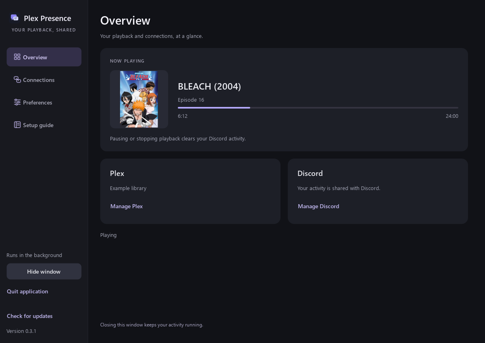
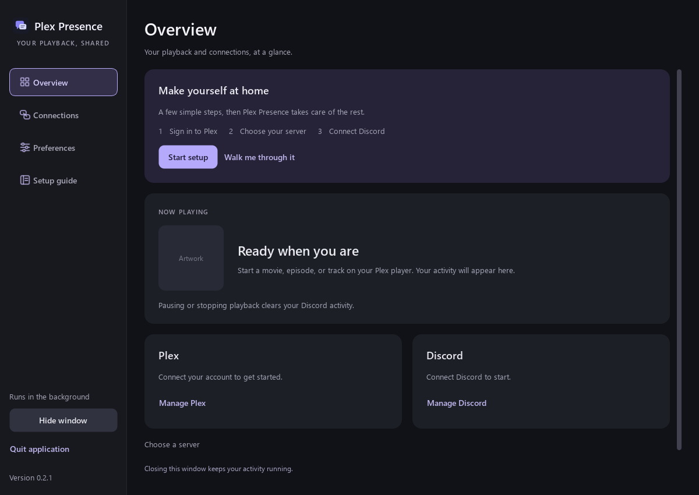
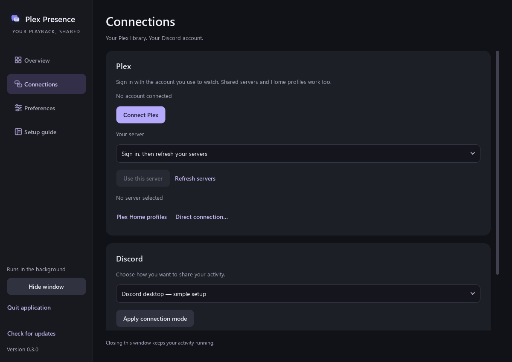
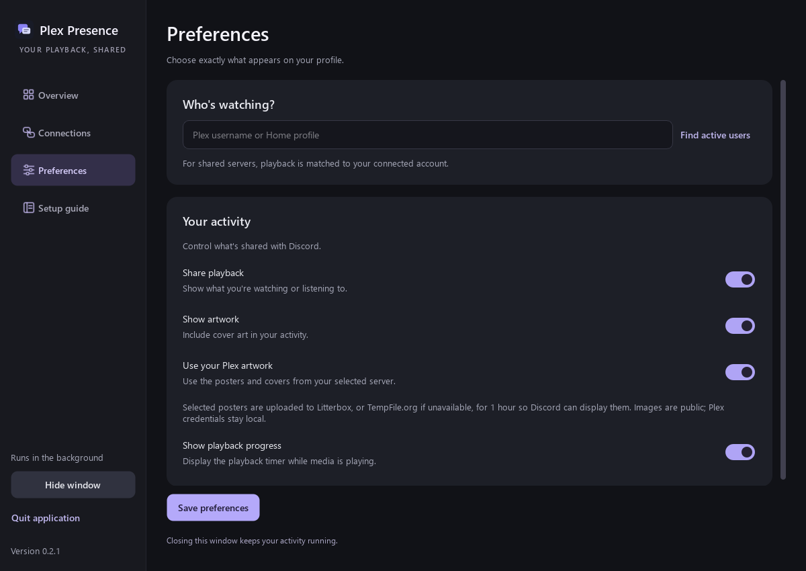
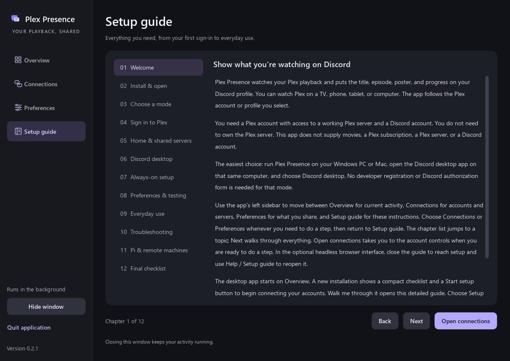
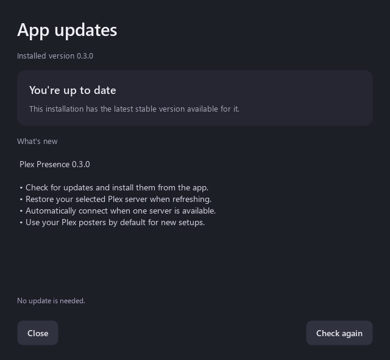
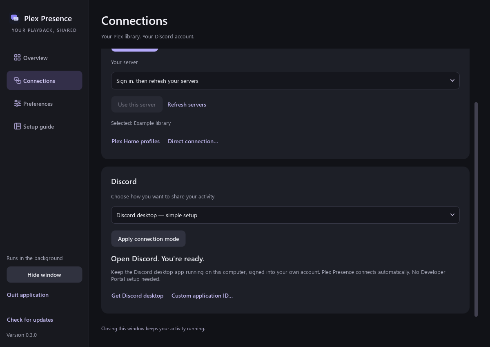
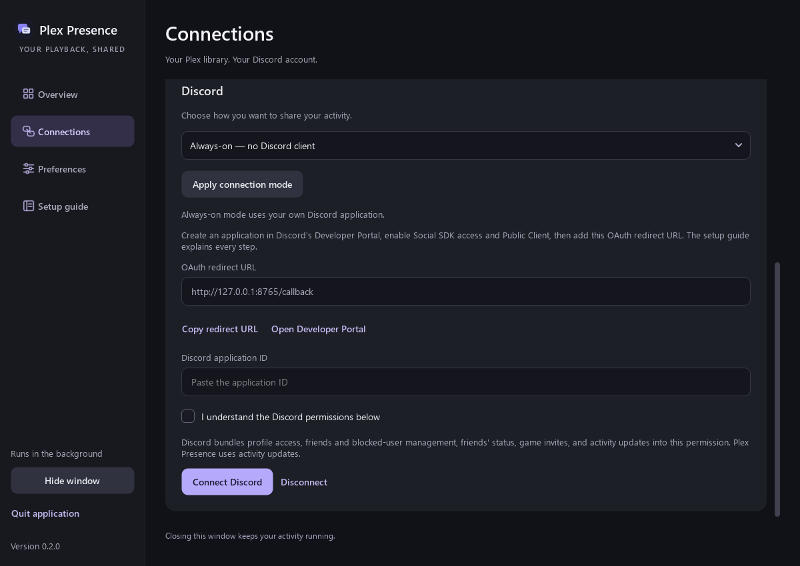
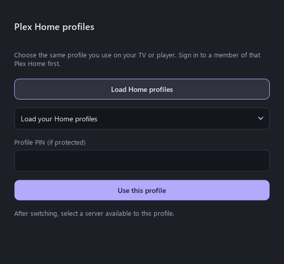

# Plex Presence

Show your Plex playback on your own Discord profile, in a **native desktop application**, with a built-in setup guide and **your choice of Discord desktop or always-on mode**. Runs on Windows, macOS, Linux, and a 64-bit Raspberry Pi.

## [Download for Windows (.exe)](https://github.com/sixtenths/plex-presence/releases/latest/download/PlexPresence-Setup-windows-x64.exe)

Click to download the latest Windows installer directly. Run it, then open Plex Presence from your Start menu. Everything the app needs is included.

[macOS and Linux downloads](https://github.com/sixtenths/plex-presence/releases/latest) · [Build status](https://github.com/sixtenths/plex-presence/actions) · [Security and privacy](SECURITY.md)



The native window above is rendered with example playback data. [Explore the app screenshots below](#screenshots) or [download the full screenshot pack](https://github.com/sixtenths/plex-presence/releases/download/v0.3.1/PlexPresence-v0.3.1-screenshots.zip).

**Experimental:** Discord's OAuth permission is documented, but the headless presence publishing endpoint is not a stable public API. Discord may change or disable it. Always-on mode requires your own Discord application and Social SDK; desktop mode does not. This independent community project is inspired by [phin05/discord-rich-presence-plex](https://github.com/phin05/discord-rich-presence-plex).

## Features

- Configure accounts and preferences in a dedicated desktop window with native controls. A browser is used for account sign-in and external links, not as the desktop settings interface.
- Keep watching in the background when the window is closed; reopen it from the shortcut or Windows tray icon.
- Sign in to Plex and choose your own server, or enter an address and token using **Direct connection…**.
- Select the Plex username to track and authorize your own Discord account.
- Show movies, episodes, and music, with your selected Plex artwork and playback progress enabled by default. Both can be turned off in Preferences.
- Shows tagged **Anime** in Plex genres or labels use **Episode 42** instead of **S03E01**. Numbering follows Plex's regular-season order, excludes season-zero specials, and uses an explicit absolute index when available. It also detects shows whose episode indices already continue across seasons, avoiding double counting. Otherwise it adds the highest episode index in each earlier season; incomplete libraries or alternative ordering can differ from an external anime database. Unavailable metadata or missing whole earlier seasons retains the standard season/episode label.
- **Clear presence on pause, stop, buffering, or loss of server access.** Resume restores it. No paused activity or paused timer.
- Save settings locally and refresh Discord authorization automatically.
- Check for stable releases from the app and choose when to download and install an update.
- Run on an always-on machine without leaving Discord open. The Plex server must still be running: a Pi cannot see playback from a powered-off PC.

Playback is polled roughly every five seconds. Network latency, Plex session reporting, Discord caching, and rate limits can delay updates. Disabling progress removes the supplied playback timestamps; Discord may still display its own activity duration.

## Download and run

**Windows: download [PlexPresence-Setup-windows-x64.exe](https://github.com/sixtenths/plex-presence/releases/latest/download/PlexPresence-Setup-windows-x64.exe), run the installer, then open Plex Presence from its Start menu or desktop shortcut.** It installs for your Windows user, includes Python and dependencies, and registers an uninstaller. For a manual upgrade, quit the app before running the new installer. Uninstall permanently removes the program and its local accounts, settings, window preferences, caches, and downloaded updates. Normal upgrades keep your settings. Starting with v0.3.2, custom data folders used by the installed app are tracked too: uninstall removes the app files in those folders while preserving unrelated files. Install or update to v0.3.2 before uninstalling to get this behavior.

The app opens on **Overview**, with a compact setup checklist and a **Start setup** button for a new installation. **Walk me through it** opens the detailed guide. **Connections** contains your accounts and servers, and **Preferences** controls what you share. Choose **Setup guide** in the left sidebar for the detailed **12-part walkthrough** covering installation, Plex Home, shared servers, both Discord modes, artwork, troubleshooting, everyday use, privacy, and Raspberry Pi setup.

On macOS/Linux, choose the archive for your machine and extract the **whole folder** before launching. All native downloads include Python and dependencies.

| Platform | Download | Launch |
| --- | --- | --- |
| Windows x64 | `PlexPresence-Setup-windows-x64.exe` | Install, then use the Plex Presence shortcut |
| macOS Apple Silicon | `PlexPresence-macos-arm64.zip` | `PlexPresence.app` |
| macOS Intel | `PlexPresence-macos-x64.zip` | `PlexPresence.app` |
| Linux / Raspberry Pi arm64 | `PlexPresence-linux-arm64.tar.gz` | `./PlexPresence/PlexPresence` |
| Linux x64 | `PlexPresence-linux-x64.tar.gz` | `./PlexPresence/PlexPresence` |

Builds are unsigned and macOS builds are not notarized. Windows SmartScreen or macOS Gatekeeper may require approval using the OS's normal per-app controls. Use only downloads from this repository. Running from source is also supported.

Native builds are tested on the current Windows GitHub runner, macOS 15 (both architectures), and Ubuntu 22.04 (both architectures). Older operating systems are not guaranteed. Linux binaries require glibc 2.35 or newer; Alpine/musl is unsupported. For older compatible Linux systems, use Python 3.11+ from source. No 32-bit Pi or Windows ARM native build is supplied.

Launching Plex Presence opens its own desktop window. Closing that window hides it while the watcher continues running. Reopen it with the application shortcut or the Windows tray menu. Use **Quit application** in the window or **Quit Plex Presence** in the Windows tray menu to stop the process and clear presence.

The Windows installer enables **Start when I sign in** by default; you can uncheck it during installation or disable Plex Presence in Windows Startup apps. Startup uses `--background`, which keeps the desktop window hidden until you open it. Right-click the tray icon for **Open settings / setup guide** or **Quit Plex Presence**. Launching the Start menu shortcut again brings the existing application window back. macOS/Linux users can configure login startup using their OS or service manager.

Plex sign-in and Always-on Discord authorization still use the provider's website in your usual browser. After approving, return to the Plex Presence window. The local callback address is used for authorization; it is not the desktop configuration interface. The optional browser interface remains available for Pi/headless administration over an SSH tunnel, as described below.

## Updating the app

**On v0.2.x or earlier? Download and install v0.3.1 or later once to get the update button.** Existing account settings and saved preferences are kept.

1. Save any changed preferences, then click **Check for updates** near the bottom of the sidebar.
2. The app checks this project's latest stable GitHub release and shows its version and release notes.
3. If an update is available, click **Download and install**. The app downloads the package for your device and verifies its published SHA-256 checksum.
4. Wait for the app to close, install the update, and reopen. It resumes with the same settings folder and local port.

Windows updates inside the app require a copy installed through the Windows installer. On macOS/Linux, the complete app must be in a folder your user can change; a read-only disk image or protected folder cannot be updated this way. The previous macOS/Linux app folder is retained as a recovery copy during replacement. Source copies can check versions and open the release page, but are not replaced by the updater. If installation is unavailable, use **Open GitHub release** and follow the manual download instructions.

There are no automatic startup checks or unattended updates. Checking does not install anything; installation begins only after you choose **Download and install**. Checksums verify download integrity and do not provide code signing or notarization.

## Screenshots

These screenshots show the native desktop interface in v0.3.1. Playback and account details are examples. Click any image to view it at full size.

| First-time setup | Plex connections |
| --- | --- |
| [](docs/screenshots/overview-setup.png) | [](docs/screenshots/connections.png) |

| Sharing preferences | Built-in setup guide |
| --- | --- |
| [](docs/screenshots/preferences.png) | [](docs/screenshots/guide.png) |

**Updates inside the app**

[](docs/screenshots/updates.png)

<details>
<summary>See Discord connection modes and Plex Home profiles</summary>

| Discord desktop | Always-on / no Discord client |
| --- | --- |
| [](docs/screenshots/discord-desktop.png) | [](docs/screenshots/discord-always-on.png) |

**Plex Home profiles**

Choose the profile used on your player, including a managed profile with a PIN.

[](docs/screenshots/plex-home.png)

</details>

[Download the full screenshot pack](https://github.com/sixtenths/plex-presence/releases/download/v0.3.1/PlexPresence-v0.3.1-screenshots.zip), including advanced connection dialogs and a compact window.

## First-time setup

### 1. Plex

Choose **Connections** in the left sidebar, then click **Connect Plex**, sign in on Plex's website, and approve the connection. Return to the Plex Presence window and click **Refresh servers** if needed. A saved server selection is restored when it is still accessible. If no accessible selection is saved and your account has exactly one server, the app connects to it automatically. If several servers are available, choose one and click **Use this server**. Refreshing an already selected server does not interrupt playback. Servers you own use session polling. Shared servers use a playback notification connection authenticated with your personal shared-server token, without requesting the owner-only session list.

Enter the Plex username to track. **Find active users** suggests names from current playback; start a stream if a name is missing, or type the exact username yourself. In shared-server mode the tracked user is locked to the signed-in profile. After connecting or restarting the app, start or resume playback so Plex sends a fresh event. You still need library access and a reachable server; an offline server or denied notification connection cannot be bypassed.

**Connections → Direct connection…** accepts your server URL, token, and username. Prefer HTTPS. Local HTTP sends the token unencrypted on your network. Never put a token in the URL or a public issue.

### Plex Home / managed profiles

If you watch as a Plex Home profile, open **Connections → Plex Home profiles**, click **Load Home profiles**, select the profile, and enter its four-digit PIN if protected. Click **Use this profile**. The app refreshes that profile's accessible servers and connects automatically if there is exactly one; otherwise choose the server you watch from. This obtains that profile's own access token; the PIN is not saved. You do not need the server owner's token.

A managed profile cannot sign in independently: an existing full member of its Plex Home first signs in normally, then switches to the profile. The original login token is retained locally to allow later profile switching. Switching profiles clears the previous server selection. Regular shared users simply sign in with their own Plex account and choose a server marked **(shared)**; no Home switch is needed.

The notification listener reconnects automatically and clears presence on pause, stop, disconnection, or when playback events go stale. It does not request control of the Plex player. See [Plex Home switching](https://support.plex.tv/articles/204232453-fast-user-switching/) and [managed accounts](https://support.plex.tv/articles/203948776-managed-users/).

### 2. Discord

**Discord desktop (default):** open Discord on the same Windows, macOS, or Linux computer and sign in. Plex Presence connects automatically. No developer registration or OAuth consent is needed. The default public application ID supplies the Plex app name; it is not a credential or connection to the project owner's account or server. Advanced users can enter a custom Application ID. Browser-only Discord, phones, and tablets do not provide this local connection.

**Always-on / no Discord client:** choose this mode and click **Apply connection mode**, then follow these steps:

1. Open the [Developer Portal](https://discord.com/developers/applications) and create your own application, for example **Plex**. Its name can appear on your profile.
2. Under **Social SDK → Getting Started**, complete the activation form with your own details and enable Social SDK. Otherwise authorization can fail with `invalid_scope`.
3. Under **OAuth2**, enable **Public Client** and save.
4. Add the exact redirect URL displayed in the GUI: normally `http://127.0.0.1:8765/callback`. Save it.
5. Copy the **Application ID** into the GUI. No client secret or bot token is needed.
6. Review the permission note and click **Connect Discord**. Check the signed-in Discord account and authorize the app.

Scopes are `openid sdk.social_layer_presence`, using PKCE. Discord bundles profile, social/friend, invite, and activity permissions into the presence scope; review the actual consent screen. This app uses authorization refresh and presence publishing. See [Discord's scope documentation](https://docs.discord.com/developers/discord-social-sdk/core-concepts/oauth2-scopes).

Every install has separate credentials. Nothing connects to the project owner's Plex server or Discord account. Desktop mode shares a public application identifier for the app name; always-on mode uses your own app. To switch Discord accounts, disconnect first and reconnect using the intended account in your browser. Disconnect removes local tokens; revoke the grant remotely in Discord's **Authorized Apps** settings.

### 3. Playback

Open **Preferences**, save your choices, and start Plex playback. The desktop window shows the Plex state and whether Discord accepted an update. Pause or stop to clear it. Public posters are fitted inside a square canvas to preserve proportions; Discord controls its card layout.

**Use your Plex artwork** is enabled for new installations and configurations that do not yet have this setting. The app uses the poster selected on your Plex server. Existing saved choices are preserved, including an explicit off setting. Turn it off in Preferences to use public-provider artwork instead, or turn off **Show artwork** to share no image. See the image-upload details below.

## Run from source

Requires Python 3.11+ and Git. The desktop interface uses native Qt widgets through `PySide6-Essentials`; it does not embed a browser or WebView. `pip install .` installs the Qt bindings and runtime dependencies alongside `websocket-client`, `pypresence`, and the Windows tray dependencies. Native downloads bundle these dependencies. Linux desktop use also needs a graphical session and the system libraries required by Qt; `--no-browser` runs without creating a desktop window.

```sh
git clone https://github.com/sixtenths/plex-presence.git
cd plex-presence
python -m venv .venv
```

Windows:

```powershell
.venv\Scripts\python.exe -m pip install .
.venv\Scripts\python.exe -m plex_presence
```

macOS / Linux (use `python3` for the initial venv command if needed):

```sh
.venv/bin/python -m pip install .
.venv/bin/python -m plex_presence
```

After installing dependencies, you can also run `python run.py` from the checkout.

## Pi / headless setup

Use `--no-browser` for a remote machine without a desktop session. This keeps the watcher and local administration endpoint running without creating the native window. Start the bundled executable, or the Python entry point:

```sh
python3 -m plex_presence --no-browser
```

From your desktop, forward the setup port over SSH using your own username and machine:

```sh
ssh -N -L 8765:127.0.0.1:8765 user@your-server
```

For this headless administration path, open `http://127.0.0.1:8765` in your desktop browser. Keep the tunnel connected until Discord redirects back. The watcher must keep running on the remote machine after setup. For persistent startup, run the same command under your preferred service manager as your regular user.

Do not expose the setup port to the internet. If 8765 is busy, use `--port 8790`, forward 8790 at both ends, and save the new redirect URL in your Discord application. `--data-dir PATH` selects another configuration directory. Only one instance can use a given directory.

## Privacy and local files

| OS | Default data directory |
| --- | --- |
| Windows | `%LOCALAPPDATA%\PlexPresence` |
| macOS | `~/Library/Application Support/PlexPresence` |
| Linux | `$XDG_CONFIG_HOME/plex-presence`, or `~/.config/plex-presence` |

Credentials are local plaintext files protected by user/file permissions, not a keychain. Never share them. There is no telemetry or central project backend. **Use your Plex artwork** is enabled by default when no saved choice exists. It uploads the exact poster selected on your Plex server to Litterbox (or TempFile.org if Litterbox is unavailable) for one hour, then fits it through [images.weserv.nl](https://images.weserv.nl/). Anyone with the image URL can view it, and Discord/proxy caches may last longer. Plex credentials and server addresses are never sent to these image services. Turn off **Use your Plex artwork** to use public-provider poster URLs without uploading the server's selected image, or turn off **Show artwork** to avoid artwork requests entirely. Existing saved off settings remain off after updating. If artwork is unavailable, presence works without an image.

## Troubleshooting

| Symptom | Check |
| --- | --- |
| `invalid_scope` | Enable Social SDK on your Discord app, then reconnect. |
| Code exchange failed | Public Client enabled, exact redirect saved, same port and app ID. |
| Server cannot connect | Reachability, TLS certificate, the selected profile’s library access and notification/session permissions. |
| No playback | Server on, correct server and exact Plex username, playback active. |
| Paused activity briefly lingers | Allow a poll and Discord refresh; check GUI retry status. |
| Cannot start | Port or data directory already in use, file permissions, or missing graphical desktop/Qt system libraries. Use `--no-browser` for headless systems. |
| Window disappeared after closing it | The watcher stays running. Launch the shortcut or use the Windows tray menu to reopen settings. |
| Missing image | Show artwork enabled, selected Plex poster available, and image host/proxy reachable. If using public-provider artwork instead, a supported public poster must exist. |
| Discord asks to reconnect | Disconnect and authorize again; verify Social SDK is enabled. |

## Development

```sh
python -m unittest discover -s tests_public -v
python -m pip install pyinstaller==6.22.3
python packaging/build.py
python tests_public/smoke_bundle.py
```

Build on the target OS and architecture. Windows requires Inno Setup 6 (ISCC.exe on PATH or its default installation directory). GitHub Actions runs tests, packages each app, then launches each native bundle to test its local service API and shutdown. Version tags publish release downloads and SHA-256 checksums only after every native job passes. Tests use mocked account responses and never require live credentials.

## License

[GNU AGPL v3](LICENSE). See [NOTICE.md](NOTICE.md). Not affiliated with Plex or Discord.
